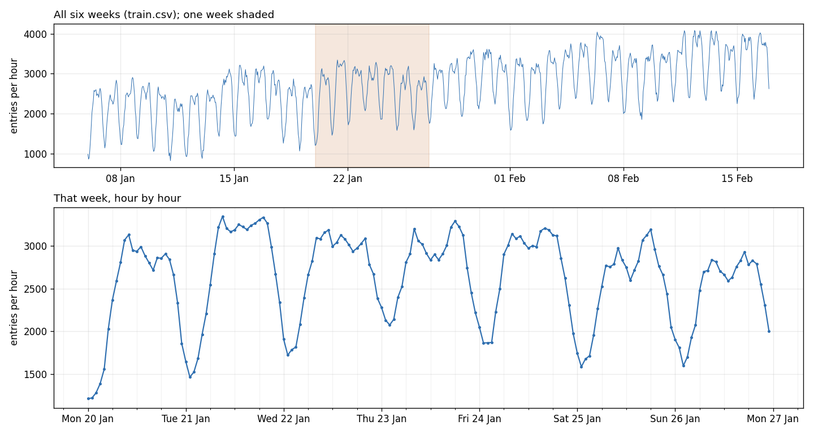

# Lesson 1: Metro footfall

A busy metro interchange opened a few months ago and runs around the clock. The gates count how many people enter each hour. You have the last six weeks of those counts. The station manager has to plan staff for the next two weeks and asks you for an hour-by-hour forecast.

## The data
- `train.csv`: six weeks of hourly counts, 1,008 rows, starting Monday 6 Jan 2025 00:00.
  - `time`: the start of the hour (`YYYY-MM-DD HH:MM`)
  - `footfall`: people who entered in that hour
- `future.csv`: the next two weeks (336 rows), same columns. **Hold it back:** don't open it until you've saved your forecast. It's only for scoring.

## The data, up close

One row per hour. The top panel is the whole training period; the bottom is one ordinary week, hour by hour.

The first rows:

| time | footfall |
| --- | --- |
| 2025-01-06 00:00 | 989 |
| 2025-01-06 01:00 | 869 |
| 2025-01-06 02:00 | 915 |
| 2025-01-06 03:00 | 1143 |
| 2025-01-06 04:00 | 1394 |

## Your task
1. Forecast footfall for every hour of the two weeks after the data ends.
2. Score your forecast against `future.csv`: the typical error over the first day, the first week and the full two weeks.
3. Answer in one line: which approach would you trust, how far ahead, and why?

## How to work
- Open [`prompt.md`](prompt.md), copy all of it into your AI chat, and answer its first question.
- Or open the notebook in Colab: [starter.ipynb](https://colab.research.google.com/github/AbhinnV04/quant-research-ai-workflows/blob/main/lessons/01-metro-footfall/starter.ipynb).
- You make the calls. The AI does the computing.
