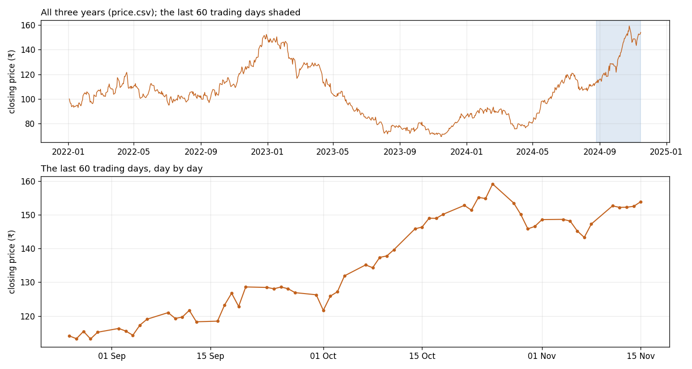

# Lesson 2: The price chart

Saffron Valley Instruments (SVI) is a listed company. You have three years of its daily closing share price, from January 2022 to November 2024. It has had good years and bad ones. Your job: say where the price will be next month and next year, and how sure you are.

## The data
| File | What's in it | When to open it |
| ---- | ------------ | --------------- |
| `price.csv` | `date` (trading days, YYYY-MM-DD) and `close` (closing price in rupees). 750 rows, 2022-01-03 to 2024-11-15. | Now |
| `future.csv` | The next 250 trading days, same columns. | Don't open it until you've written your forecasts down. Then use it only to score them. |
| `news.csv` | `date` and `news_score`: a daily score of the news about SVI (positive is good news, negative is bad), for the same 750 days as `price.csv`. | After you've scored your forecasts. |

## The data, up close

One row per trading day (no weekends). The top panel is the whole history; the bottom is the last three months before your forecast starts.

The first rows:

| date | close |
| --- | --- |
| 2022-01-03 | 100.0 |
| 2022-01-04 | 97.68 |
| 2022-01-05 | 96.33 |
| 2022-01-06 | 96.29 |
| 2022-01-07 | 93.67 |

## Your task
1. Forecast the closing price 20 trading days after the last date (one month) and 250 trading days after it (one year). Give each one as a number and a range you'd stand behind.
2. Write both down. Then open `future.csv` and score yourself: how far off were you, and did the truth land inside your range?
3. Open `news.csv` and look at it next to the price. Finish with one line: what would you need to forecast this price better?

## How to work
- Copy [`prompt.md`](prompt.md) into your AI chat and answer its first question.
- Or open the notebook in Colab: 
- Using Claude Code, Cursor or Copilot in a clone of this repo? Say "start lesson 2".
- You make the calls. The AI does the computing.
