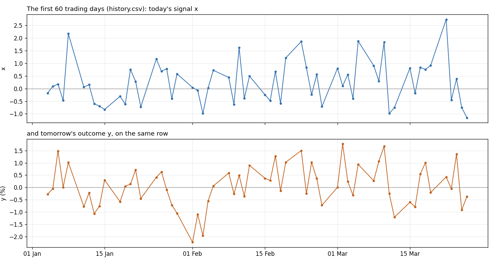

# Lesson 3: The useless signal

You have a daily signal, `x`, and an outcome, `y`. Every evening you know today's `x`, and you'd like to use it to predict tomorrow's `y`.

A colleague has already checked. They ran the correlation between `x` and `y` over three years of history, got about zero, and now want to drop `x` as useless.

Are they right?

## The data
- `history.csv`: 750 trading days. Columns:
  - `date`: the day `x` was known;
  - `x`: the signal, a unitless score;
  - `y`: the outcome on the next trading day, in %.

  Each row pairs today's `x` with tomorrow's `y`, so they're already lined up for prediction.
- `future.csv`: the next 250 days, same columns. **Hold it back:** don't open it until you've written your answer.

## The data, up close

One row per trading day: today's `x` next to tomorrow's `y`. These are the first three months only.

The first rows:

| date | x | y |
| --- | --- | --- |
| 2021-01-04 | -0.176 | -0.272 |
| 2021-01-05 | 0.09 | -0.054 |
| 2021-01-06 | 0.176 | 1.488 |
| 2021-01-07 | -0.471 | 0.008 |
| 2021-01-08 | 2.173 | 1.02 |

## Your task
1. Decide: is `x` useless for predicting `y`? Yes or no, with the evidence, in one paragraph.
2. If you decide it's useful: write a rule that predicts tomorrow's `y` using only what's known today. Fit it on `history.csv`.
3. Write your answer down. Then open `future.csv` and score your rule: R², against a model that ignores `x`.

## How to work
- **AI chat:** open [`prompt.md`](prompt.md), copy all of it into your AI chat, and answer its first question.
- **Colab:** [open the starter notebook](https://colab.research.google.com/github/AbhinnV04/quant-research-ai-workflows/blob/main/lessons/03-the-useless-signal/starter.ipynb). It loads `history.csv` for you.
- **AI coding agent** (Claude Code, Cursor, Copilot) in a clone of this repo: say "start lesson 3".

You make the calls. The AI does the computing.
