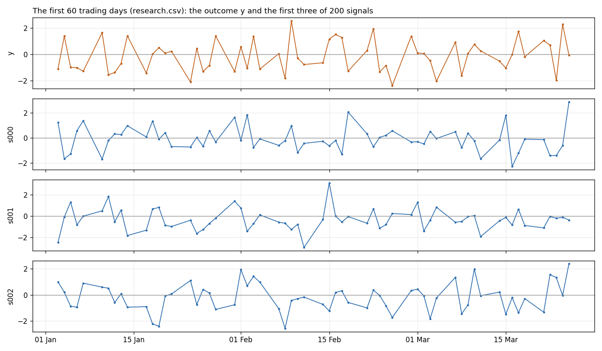

# Lesson 4: Two hundred signals

A colleague has built 200 candidate signals. Each one is a number they can compute at the end of every trading day. They want to know which of them predict tomorrow's outcome, `y`, a daily number that behaves like a return.

You get two years of data to research. Two more years sit in a separate file, held back.

## The data
- `research.csv`: 500 trading days, one row per day.
  - `date`: the day the signals are known (end of day).
  - `y`: the outcome on the **next** trading day. Each row already pairs today's signals with tomorrow's outcome.
  - `s000` to `s199`: the 200 signals. Plain numbers, no units.
- `holdout.csv`: the next 500 trading days, with the same columns. **Hold it back:** don't open it until you've written down your answer.

## The data, up close

One row per trading day: today's 200 signals next to tomorrow's `y`. Shown here: `y` and the first three signals, for the first three months.

The first rows:

| date | y | s000 | s001 | s002 | s199 |
| --- | --- | --- | --- | --- | --- |
| 2022-01-03 | -1.1148 | 1.232 | -2.471 | 0.988 | 0.019 |
| 2022-01-04 | 1.3964 | -1.651 | -0.098 | 0.202 | -1.095 |
| 2022-01-05 | -0.986 | -1.27 | 1.305 | -0.874 | -0.589 |
| 2022-01-06 | -1.005 | 0.575 | -0.817 | -0.94 | 0.857 |
| 2022-01-07 | -1.2769 | 1.353 | -0.017 | 0.89 | -0.006 |

## Your task
Decide which signals, if any, predict `y`.
1. Write a short list. For each signal on it, give a one-line claim, and the result on `holdout.csv` that would prove the claim wrong.
2. Only then, open `holdout.csv`, test each claim, and give your verdict.

## How to work
- Open [`prompt.md`](prompt.md), copy all of it into your AI chat, and answer its first question.
- Or open the notebook in Colab: [starter.ipynb](https://colab.research.google.com/github/AbhinnV04/quant-research-ai-workflows/blob/main/lessons/04-two-hundred-signals/starter.ipynb).
- You make the calls. The AI does the computing.
